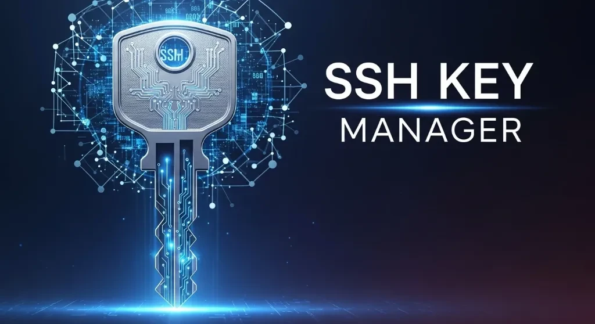

# SSH Key Manager

Readme: [EN](README.md)

[](LICENSE)
[](https://github.com/sr00t3d/key_manager/releases)
[](https://www.gnu.org/software/bash/)



**SSH Key Manager v3.1.0** e uma ferramenta CLI em Bash que automatiza a geracao de pares de chaves OpenSSH (`ed25519` por padrao ou `rsa` 4096 bits), aplicacao de permissoes estritas (`0700`/`0600`/`0644`), inspecao de fingerprint SHA256, verificacao isolada com `IdentitiesOnly=yes`, deploy remoto via `ssh-copy-id` e registro de auditoria.

---

## Funcionalidades

- **Criptografia Moderna por Padrao**: gera chaves `ed25519` por padrao (com `-t rsa` para RSA 4096 bits) e detecta automaticamente o algoritmo de chaves existentes
- **Isolamento de Identidade (`IdentitiesOnly=yes`)**: testa exatamente a chave alvo sem falsos positivos por fallback do `ssh-agent`
- **Tratamento Seguro de Credenciais**: aceita senha via variavel de ambiente `SSHPASS` (`sshpass -e`) sem expor segredos no `ps aux`
- **Host Keys Seguras**: utiliza `StrictHostKeyChecking=accept-new` e flag `-k / --refresh` para limpar entradas antigas no `known_hosts` sem apagar chaves de outros administradores no `authorized_keys` remoto
- **Aplicacao de Permissoes**: garante `0700` no `--key-dir`, `0600` na chave privada e `0644` na chave publica
- **Modos Nao-Interativos**: `--check-only`, `--no-connect`, `--dry-run` e `--no-audit` para automacoes e pipelines CI/CD
- **Saida Multi-Formato (`-o table|json|csv`)**: tabela ASCII, JSON ou CSV com fingerprint SHA256

---

## Requisitos

- Linux/macOS com Bash 4+
- Cliente OpenSSH (`ssh`, `ssh-keygen`, `ssh-copy-id`)
- `sshpass` (necessario apenas no primeiro deploy autenticado por senha)

---

## Instalacao

```bash
curl -fsSLO https://raw.githubusercontent.com/sr00t3d/key_manager/main/key_manager.sh
chmod +x key_manager.sh
```

---

## Uso

```bash
./key_manager.sh <HOST> [OPCOES]

Opcoes:
  -u, --user USUARIO      Usuario SSH remoto (padrao: root)
  -P, --port PORTA        Porta SSH remota (padrao: 22)
  -t, --type TIPO         Algoritmo da chave: ed25519 (padrao) ou rsa (4096 bits)
  -n, --key-name NOME     Nome do arquivo da chave em --key-dir (padrao: id_<tipo>)
  --key-dir DIR           Diretorio de armazenamento de chaves (padrao: ~/.ssh)
  -c, --comment TEXTO     Comentario customizado na chave SSH
  -p, --password SENHA    Senha remota para primeiro deploy (prefira variavel SSHPASS)
  -k, --refresh           Remove entrada antiga do host no known_hosts antes de conectar
  --check-only            Valida chave local e autenticacao remota sem fazer deploy ou abrir shell
  --no-connect            Encerra apos validacao/deploy sem abrir shell interativo
  --no-audit              Nao grava registro em /var/log/key.audit no host remoto
  --dry-run               Simula acoes sem criar chaves nem alterar o host remoto
  -o, --output FORMATO    Formato de saida: table (padrao), json, csv
  -q, --quiet             Suprime saida padrao (mantem erros em stderr)
  --no-color              Desativa cores ANSI
  -V, --version           Exibe a versao e encerra
  -h, --help              Exibe a ajuda e encerra
```

### Exemplos

```bash
# Simular geracao e verificacao sem alterar arquivos
./key_manager.sh servidor.exemplo.com.br -u root -P 2222 --dry-run

# Validar chave existente de forma nao-interativa (CI/CD / monitoramento)
./key_manager.sh servidor.exemplo.com.br -u root -P 2222 -n id_ed25519 --check-only -o json

# Deploy de chave via variavel SSHPASS sem abrir shell interativo
SSHPASS='segredo' ./key_manager.sh servidor.exemplo.com.br -u admin --no-connect -o csv

# Gerar chave RSA 4096 em diretorio isolado
./key_manager.sh servidor.exemplo.com.br --key-dir /root/.ssh-prod -t rsa -n id_prod --no-connect
```

---

## Exemplo de Saida Real

Capturado contra servidor de testes AlmaLinux 8.10 com cPanel/WHM:

### Saida em tabela (`--check-only`)

```text
$ ./key_manager.sh root.perciocastelo.com.br -u root -P 22228 -n id_rsa --check-only --no-audit --no-color

SSH Key Manager v3.1.0
+------------------+--------------------------------------------------------+
| Field            | Value                                                  |
+------------------+--------------------------------------------------------+
| Target           | root@root.perciocastelo.com.br:22228                   |
| Key Path         | /home/sr00t3d/.ssh/id_rsa                              |
| Key Type         | rsa (EXISTS)                                           |
| Fingerprint      | SHA256:SsWBqffb/sEbQQVEr9sQ/E0J2jpwar4JizroireMQek     |
| Auth Status      | AUTHORIZED                                             |
| Action           | VERIFIED                                               |
| Remote Audit     | SKIPPED                                                |
| Overall Status   | SUCCESS                                                |
| Timestamp        | 2026-11-20T05:36:24Z                                   |
+------------------+--------------------------------------------------------+
```

### Simulacao Dry-Run (`--dry-run`)

```text
$ ./key_manager.sh root.perciocastelo.com.br -u root -P 22228 --key-dir /tmp/km-e2e -n id_test_ed25519 --dry-run --no-color

SSH Key Manager v3.1.0
+------------------+--------------------------------------------------------+
| Field            | Value                                                  |
+------------------+--------------------------------------------------------+
| Target           | root@root.perciocastelo.com.br:22228                   |
| Key Path         | /tmp/km-e2e/id_test_ed25519                            |
| Key Type         | ed25519 (WOULD_GENERATE)                               |
| Fingerprint      | (pending generation)                                   |
| Auth Status      | WOULD_CHECK                                            |
| Action           | DRY_RUN                                                |
| Remote Audit     | SKIPPED                                                |
| Overall Status   | DRY_RUN                                                |
| Timestamp        | 2026-11-20T05:36:24Z                                   |
+------------------+--------------------------------------------------------+
```

### Saida JSON (`-o json`)

```json
{
  "version": "3.1.0",
  "status": "SUCCESS",
  "target": "root@root.perciocastelo.com.br:22228",
  "key_path": "/home/sr00t3d/.ssh/id_rsa",
  "key_type": "rsa",
  "key_state": "EXISTS",
  "fingerprint": "SHA256:SsWBqffb/sEbQQVEr9sQ/E0J2jpwar4JizroireMQek",
  "auth_status": "AUTHORIZED",
  "action": "VERIFIED",
  "audit": "SKIPPED",
  "dry_run": false,
  "timestamp": "2026-11-20T05:36:27Z"
}
```

### Saida CSV (`-o csv`)

```csv
timestamp,target,key_path,key_type,key_state,fingerprint,auth_status,action,audit,status
2026-11-20T05:36:30Z,"root@root.perciocastelo.com.br:22228","/home/sr00t3d/.ssh/id_rsa",rsa,EXISTS,"SHA256:SsWBqffb/sEbQQVEr9sQ/E0J2jpwar4JizroireMQek",AUTHORIZED,VERIFIED,SKIPPED,SUCCESS
```

---

## Licenca

Apache-2.0. Consulte [LICENSE](LICENSE) para detalhes.

## Autor

[Percio Castelo](https://perciocastelo.com.br)
