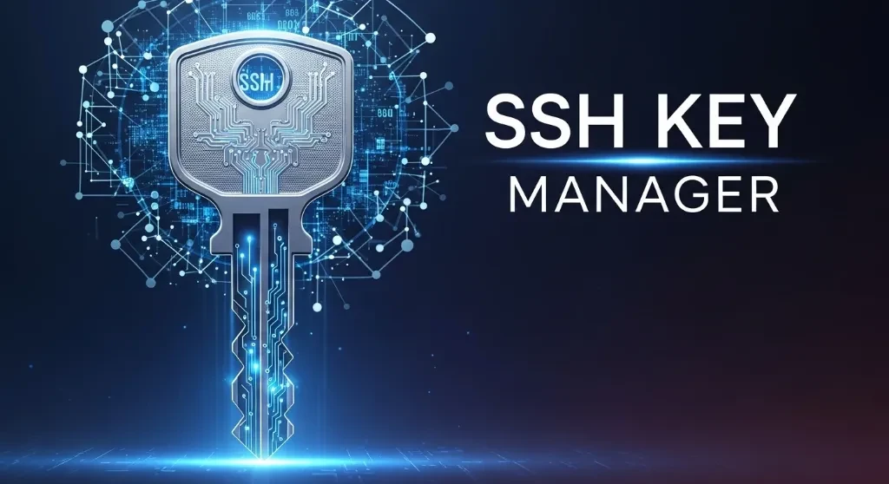

# SSH Key Manager

Readme: [PT-BR](README-ptbr.md)

[](LICENSE)
[](https://github.com/sr00t3d/key_manager/releases)
[](https://www.gnu.org/software/bash/)



**SSH Key Manager v3.1.0** is a Bash CLI tool that automates OpenSSH keypair generation (`ed25519` by default, or 4096-bit `rsa`), strict permission enforcement (`0700`/`0600`/`0644`), SHA256 fingerprint inspection, isolated `IdentitiesOnly=yes` verification, remote deployment via `ssh-copy-id`, and remote audit logging.

---

## Features

- **Modern Cryptography Default**: generates `ed25519` keys by default (with `-t rsa` for 4096-bit RSA) and automatically detects the algorithm of existing keys
- **Strict Identity Isolation (`IdentitiesOnly=yes`)**: validates the exact target key without false positives from `ssh-agent` fallback
- **Safe Credential Handling**: reads passwords via `SSHPASS` environment variable (`sshpass -e`) so secrets never appear in `ps aux`
- **Safe Host Key Handling**: uses `StrictHostKeyChecking=accept-new` and optional `-k / --refresh` to prune stale `known_hosts` entries without wiping other admins' remote `authorized_keys`
- **Permission Enforcement**: automatically enforces `0700` on `--key-dir`, `0600` on private keys, and `0644` on public keys
- **Non-Interactive Modes**: `--check-only`, `--no-connect`, `--dry-run`, and `--no-audit` for CI/CD and fleet automation
- **Multi-Format Reporting (`-o table|json|csv`)**: ASCII table, JSON, or CSV output including SHA256 fingerprints

---

## Requirements

- Linux/macOS with Bash 4+
- OpenSSH client (`ssh`, `ssh-keygen`, `ssh-copy-id`)
- `sshpass` (only required when performing initial password-based key deployment)

---

## Installation

```bash
curl -fsSLO https://raw.githubusercontent.com/sr00t3d/key_manager/main/key_manager.sh
chmod +x key_manager.sh
```

---

## Usage

```bash
./key_manager.sh <HOST> [OPTIONS]

Options:
  -u, --user USER         Remote SSH username (default: root)
  -P, --port PORT         Remote SSH port (default: 22)
  -t, --type TYPE         Key algorithm: ed25519 (default) or rsa (4096-bit)
  -n, --key-name NAME     Key filename inside --key-dir (default: id_<type>)
  --key-dir DIR           Directory storing SSH keys (default: ~/.ssh)
  -c, --comment TEXT      Custom SSH key comment
  -p, --password PASS     Remote password for initial deploy (prefer SSHPASS env var)
  -k, --refresh           Refresh host entry in known_hosts before connecting
  --check-only            Validate local key & remote pubkey auth without deploying or connecting
  --no-connect            Exit cleanly after verification/deploy without opening interactive shell
  --no-audit              Skip writing audit record to remote /var/log/key.audit
  --dry-run               Preview actions without creating keys or modifying remote host
  -o, --output FORMAT     Output format: table (default), json, csv
  -q, --quiet             Suppress standard output (errors still go to stderr)
  --no-color              Disable ANSI colors
  -V, --version           Show version and exit
  -h, --help              Show this help and exit
```

### Examples

```bash
# Preview key generation and check flow without writing files
./key_manager.sh server.example.com -u root -P 2222 --dry-run

# Verify an existing key non-interactively (CI/CD / monitoring)
./key_manager.sh server.example.com -u root -P 2222 -n id_ed25519 --check-only -o json

# Deploy key via SSHPASS env var without opening an interactive shell
SSHPASS='secret' ./key_manager.sh server.example.com -u admin --no-connect -o csv

# Generate a custom RSA 4096 key in an isolated directory
./key_manager.sh server.example.com --key-dir /root/.ssh-prod -t rsa -n id_prod --no-connect
```

---

## Real Output Example

Captured live against an AlmaLinux 8.10 cPanel/WHM test host:

### Table output (`--check-only`)

```text
$ ./key_manager.sh root.perciocastelo.com.br -u root -P 22228 -n id_rsa --check-only --no-audit --no-color

SSH Key Manager v3.1.0
+------------------+--------------------------------------------------------+
| Field            | Value                                                  |
+------------------+--------------------------------------------------------+
| Target           | root@root.perciocastelo.com.br:22228                   |
| Key Path         | /home/sr00t3d/.ssh/id_rsa                              |
| Key Type         | rsa (EXISTS)                                           |
| Fingerprint      | SHA256:SsWBqffb/sEbQQVEr9sQ/E0J2jpwar4JizroireMQek     |
| Auth Status      | AUTHORIZED                                             |
| Action           | VERIFIED                                               |
| Remote Audit     | SKIPPED                                                |
| Overall Status   | SUCCESS                                                |
| Timestamp        | 2026-11-20T05:36:24Z                                   |
+------------------+--------------------------------------------------------+
```

### Dry-run simulation (`--dry-run`)

```text
$ ./key_manager.sh root.perciocastelo.com.br -u root -P 22228 --key-dir /tmp/km-e2e -n id_test_ed25519 --dry-run --no-color

SSH Key Manager v3.1.0
+------------------+--------------------------------------------------------+
| Field            | Value                                                  |
+------------------+--------------------------------------------------------+
| Target           | root@root.perciocastelo.com.br:22228                   |
| Key Path         | /tmp/km-e2e/id_test_ed25519                            |
| Key Type         | ed25519 (WOULD_GENERATE)                               |
| Fingerprint      | (pending generation)                                   |
| Auth Status      | WOULD_CHECK                                            |
| Action           | DRY_RUN                                                |
| Remote Audit     | SKIPPED                                                |
| Overall Status   | DRY_RUN                                                |
| Timestamp        | 2026-11-20T05:36:24Z                                   |
+------------------+--------------------------------------------------------+
```

### JSON output (`-o json`)

```json
{
  "version": "3.1.0",
  "status": "SUCCESS",
  "target": "root@root.perciocastelo.com.br:22228",
  "key_path": "/home/sr00t3d/.ssh/id_rsa",
  "key_type": "rsa",
  "key_state": "EXISTS",
  "fingerprint": "SHA256:SsWBqffb/sEbQQVEr9sQ/E0J2jpwar4JizroireMQek",
  "auth_status": "AUTHORIZED",
  "action": "VERIFIED",
  "audit": "SKIPPED",
  "dry_run": false,
  "timestamp": "2026-11-20T05:36:27Z"
}
```

### CSV output (`-o csv`)

```csv
timestamp,target,key_path,key_type,key_state,fingerprint,auth_status,action,audit,status
2026-11-20T05:36:30Z,"root@root.perciocastelo.com.br:22228","/home/sr00t3d/.ssh/id_rsa",rsa,EXISTS,"SHA256:SsWBqffb/sEbQQVEr9sQ/E0J2jpwar4JizroireMQek",AUTHORIZED,VERIFIED,SKIPPED,SUCCESS
```

---

## License

Apache-2.0. See [LICENSE](LICENSE) for details.

## Author

[Percio Castelo](https://perciocastelo.com.br)
